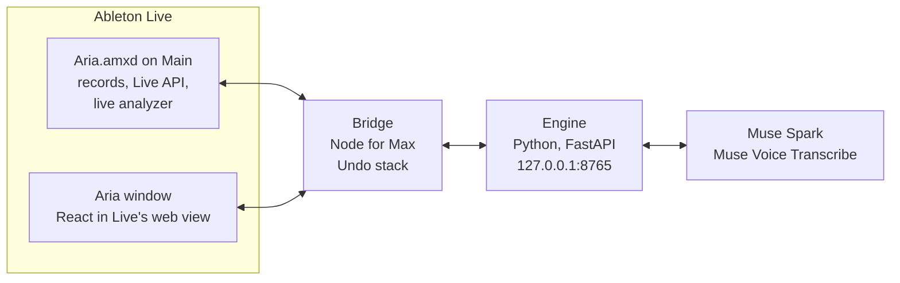

<p align="center">
  <picture>
    <source media="(prefers-color-scheme: dark)" srcset="site/public/brand/aria-logo-white.png">
    
  </picture>
</p>

<h1 align="center">Aria hears your mix and fixes it, inside Ableton.</h1>

<p align="center">
  An AI co-producer on your Main track. It finds the sounds that clash or stick out,<br>
  <b>Meta's Muse Spark</b> explains them in plain words and makes the fix in Live,<br>
  and Aria measures again to prove it worked.
</p>

<p align="center">
  <a href="https://github.com/Yumstezy/aria/releases/latest/download/Aria-mac.zip"><b>Download for Mac</b></a> ·
  <a href="https://aria-judges.vercel.app">Website</a> ·
  <a href="#install">Install</a> ·
  <a href="#meta-ai">Meta AI</a> ·
  <a href="#results">Results</a> ·
  <a href="#team">Team</a>
</p>

<p align="center"><sub>Meta Global AI Developer Hackathon · Indie track · built Oct 26 to Nov 4, 2026 · 153 engine tests</sub></p>

<br>


<p align="center"><sub>Aria's window on Ian's own song: what to fix, the reference, the song's parts and the live analyzer. Every screenshot here is the real app with real results.</sub></p>

---

## Why Aria

**Finishing a song stops at the mix.** Most producers learn to make a drop long before they learn why it sounds muddy next to the songs they love. The usual answers are an engineer, a course, or guessing with plugins. Aria works where they already are: in Ableton, on their own song.

| It finds the problem | It says it plainly | It fixes it, and proves it |
|---|---|---|
| Not a score out of 100. The sound, the range and the bars: *"SYNTH buried, 1 to 4 kHz, bars 33 to 48."* | Muse Spark writes it the way a producer would say it, from measured numbers only. Never canned text. | One tap makes the change in Live, with Undo. **Check again** measures the same bars at the same loudness and marks it **Fixed**. |

**Who it's for:** bedroom and indie producers in Ableton Live, starting with EDM, who can make the parts but can't yet hear why the whole doesn't hold up.

**What it never does:** invent a number, judge your taste, or change a third-party plugin. It changes Live's own devices; for a plugin, it draws how it should look and you set it.

---

## Install

You need a Mac, **Ableton Live 12 Suite** and **Python 3.11** ([free from python.org](https://www.python.org/downloads/macos/)).

1. **Download** [Aria-mac.zip](https://github.com/Yumstezy/aria/releases/latest/download/Aria-mac.zip) and unzip it. Move the Aria folder somewhere it can stay, like Documents.
2. **Double-click Install Aria.** The first time, your Mac may block it: right-click it and choose Open. When it's done, paste your Meta Model API key into the file it opens and save.
3. **In Live:** User Library > Presets > Audio Effects > Max Audio Effect > Aria. Drag **Aria** onto your Main track, last, and press **Check**.

The zip has the same steps, plus fixes for common problems, in **Read me first.txt**. Without a key, Aria still shows what it measured, just no advice.

<details>
<summary>From the code, and for developers</summary>

```sh
git clone https://github.com/Yumstezy/aria
cd aria
./install.sh
```

`install.sh` sets up the engine (a Python environment and `engine/.env`), links Aria and Aria Ear into Live's browser (links, so `git pull` updates them), and copies the Remote Script for "Name my tracks" (in Live, once: Settings > Link, Tempo & MIDI > Control Surface: **Aria**).

- Engine tests: `cd engine && .venv/bin/pytest` (153 passing)
- Screens: `cd ui && npm install && npm run build` (the built pages in `ui/dist/` are committed, so running Aria never needs Node)
- Websites: `cd judges && npm run build` (aria-judges.vercel.app) and `cd site && npm run build` (the product page)
- The release zip: `scripts/release.sh`
- The JSON between device, bridge, engine and screens: [`docs/contracts.md`](docs/contracts.md)
- Where things stand, day by day: [`docs/status.md`](docs/status.md)

</details>

---

## Meta AI

Meta's models do the work you see, in every screen. Not a chat box on the side.

| Model | What it does in Aria |
|---|---|
| **Muse Spark** `muse-spark-1.3` | Turns the engine's measurements into plain advice and a concrete fix, as JSON that Aria validates. It only ever sees measured numbers. |
| | **Drives Live through tool calling: 24 tools.** EQ, volume, 20 stock devices, 26 custom racks, sidechain, markers and sections, tempo, mute, solo, plugin guides, groove match, vocal sync, Check again, hearing the song, Undo. |
| | **Picks the right tool, like a mix engineer.** Drums fighting the bass get a sidechain, mud gets low cuts, harsh hits that come and go get Multiband Dynamics, a weak kick gets a punch rack. It knows each stock device's knobs and what every macro on Aria's racks moves. |
| | **Asks instead of guessing.** A real reply from testing: *"Which vocal track do you mean, VOCAL TEST or Vox 2?"* |
| | **Names the parts of a song** (Intro, Build, Drop, Break, Outro) from their measured loudness and shape. |
| | **Fixes the whole mix, then checks its own work.** "Fix my whole mix": Muse fixes the strongest problems with whatever each one needs, Aria plays the same bars again and measures each one, then Muse reports what's Fixed, from the measurements only. Press it again and it builds on its own changes instead of stacking new ones. |
| | **Looks at your screen.** Attach a screenshot of any plugin and Muse reads its settings and says exactly what to change. On a test shot of EQ Eight it read *band 4, 3.62 kHz, -3.50 dB, Q 6.00* and tied it to the harsh spot Aria had measured. |
| **Muse Voice Transcribe** `muse-voice-transcribe-1.0` | Hold the mapped key and say it. *"Cut the mud on the bass"* came back as text in 1.4 s, then ran like a typed request. |
| **Audiobox Aesthetics** | Scored all 99 rated mixes as a feature for the mix model. A side experiment, [reported honestly](#what-didnt-work): it didn't beat loudness, so it didn't ship. |

> **The guardrail.** Muse Spark never touches Live directly. It answers with actions from a fixed menu. Aria checks each one (the track exists, the gain stays within ±6 dB, the knob's unit fits) and only then applies it, with Undo. If Muse is down, Aria shows the measurements and says advice is unavailable.

---

## What it does

### Mix check

Records 16 bars of your Main track, splits it into its parts, and finds what clashes or sticks out: buried sounds, mud, harsh hits, ringing notes, bass clicks, tracks that fight. Each problem is marked on the spectrum by its kind (icon) and its range (color, lows red to highs violet). Add a reference song to compare part for part: *"Against their Drop."*


<table>
<tr>
<td width="50%" valign="top">

### Fix it, then prove it

**Fix it** asks Muse Spark for the change, and it happens in Live with Undo. **Check again** plays the same bars and measures them at the same loudness: 3 dB or more lower is **Fixed**, otherwise it comes back with **Fix it again**.

*Here: a planted harsh boost, 6.9 dB less after the fix.*

</td>
<td width="50%"></td>
</tr>
<tr>
<td width="50%"></td>
<td width="50%" valign="top">

### Ask Muse

Type or say what you want. *"Make the drums crispier." "Sync my vocal to the kick." "Tighten the bongo to the kick at 70%."* It happens right away, each change with Undo. Anything Muse suggests on its own waits for a yes.

Aria comes with 26 custom racks built from Live's stock devices, for kicks, bass, synths, space and transitions. *"My kick doesn't punch through"* loads Aria Punch Through. Everything Aria adds is named for what it does, like Aria Sidechain, so you can tell it apart from your own devices.

*Real requests from testing, typos and all, with what Aria did in green.*

</td>
</tr>
<tr>
<td width="50%" valign="top">

### Groove match

Two loops flamming? Aria finds every hit to the millisecond, moves each one onto the grid or onto another loop's feel, and writes a new clip under the original (kept, muted). Nothing is stretched. Warped loops are timed the way you hear them, through Live's warp markers.

*A perc loop following a kick loop: worst hit 15.5 ms off, now 0.*

</td>
<td width="50%"></td>
</tr>
<tr>
<td width="50%"></td>
<td width="50%" valign="top">

### Vocal sync

Drop in an acapella. Aria reads its tempo and key, puts its first beat on your kick, and warps it to your song with Live's own warp markers, which it reads back to be sure they stuck. Undo puts it back.

*Ian's vocal: A minor, beat 1 on the kick at bar 10, which sits 25.3 ms after Live's grid.*

</td>
</tr>
</table>

### Arrangement

Aria hears the whole song once, finds its parts on a 4-bar grid, and Muse Spark names them. Rename or move them, then add them to Live as markers. Every Mix check then knows which part it heard.


### Live analyzer

Your Main track as it plays: a sixth-octave spectrum against your reference, loudness to the BS.1770 standard, a stereo view with a phase meter, and a waveform colored by where the sound is.


---

## How it's built

**One rule:** the engine reports only what it measured. If it can't measure something, it says so and returns nothing. Muse gets only those numbers, and its JSON is checked before anything happens.



| Part | What it does |
|---|---|
| **The device** (`device/Aria.amxd`) | Sits last on the Main track. Records bars for a check, reads tempo, clips and warp markers, sets EQ, devices, markers and warp markers through the Live API, and runs the live analyzer: 55 bands, loudness and a stereo buffer, 20 times a second. |
| **The bridge** (`device/bridge.js`) | Node for Max. Carries messages between Live, the screens and the engine, keeps every change on an Undo stack, and starts the engine when it's needed. |
| **The engine** (`engine/`) | Python and FastAPI. Measures the audio and talks to Muse Spark. Returns numbers; the words come from Muse. |
| **The screens** (`ui/`) | React, TypeScript and Tailwind, built into single HTML files that Live's own web view loads: the strip on the device and the window docked over Live. |

**How it measures**

- **Clarity rules:** buried sounds, mud, harsh bursts, ringing notes, bass clicks and clashing tracks, from the split parts or from the producer's own tracks (Aria Ear), each with its bars and range.
- **Always at the same loudness:** reference compares and before and after are loudness matched (pyloudnorm).
- **Hits to the millisecond:** onsets pinned to the start of the attack, moved by slicing just before each hit (no stretching), then found again in the new file by cross-correlation.
- **Vocals and kicks:** tempo from how the vocal repeats over whole bars, key from the notes it uses, kicks timed by their full sound.
- **Song parts:** tempo and a 4-bar grid, parts of 8 to 32 bars, repeats share a label, Muse Spark names them.

---

## Security and privacy

| | |
|---|---|
| **Your audio stays on your Mac** | The engine runs locally and listens only on `127.0.0.1`. Recordings, stems and reference songs never leave the computer. Muse Spark gets measured numbers and your typed requests; a held-key voice request goes to Muse Voice Transcribe as a short clip. |
| **Your key stays yours** | The Meta Model API key lives in `engine/.env`, read from the environment and never committed (`.env.example` is the template). |
| **The AI can't run anything** | Muse Spark can only pick from a fixed menu of actions. Each one is checked against limits before it's applied, and every change has Undo. Muse's JSON is validated; anything off-menu is dropped. |
| **Only Aria's pages can talk to the engine** | The engine accepts browser requests only from Aria's own pages and localhost, and only `GET` and `POST`. |
| **Pinned dependencies** | Every Python library is pinned to an exact version. |

**Next (Ian, in progress):** a per-install token so nothing but Aria itself can call the engine, and a signed, notarized installer so macOS doesn't warn on first open.

---

## Results

Every number came from real audio this week, and the code that produced it is in this repo.

| Result | How it was measured |
|---|---|
| **14.9 ms → 0 ms** average lateness of a perc loop following a kick loop | Ian's loops at 165 BPM; all 32 hits found again by cross-correlation |
| **5.5 ms** worst, for a 140 BPM loop warped into a 165 song (before warp-aware timing, 21 hits moved up to 39 ms the wrong way) | Same loop, same kick, timed through Live's warp markers |
| **6.9 dB less** for a planted harsh boost after the fix, so **Fixed** | Test mix B against the clean control, loudness matched |
| **126.6 BPM** read from a 126 BPM acapella (190 before the fix); key **G# minor**, right | The vocal alone, no beat underneath |
| **22 to 25 ms**: how far Ian's kick sits after Live's grid, so a vocal lands on the kick, not the grid | His drum and vocal stems |
| **-9.2 LUFS** in the Live analyzer on Ian's drop, the same as the engine measured | BS.1770 in the device against pyloudnorm in the engine |
| **5 of 5** real requests to Muse Spark got the right tool or a clarifying question | Sync, groove at 70%, a sidechain, an unclear vocal, "did that work" |
| **Same part names three runs in a row** for a reference song | `POST /sections`, Muse Spark naming |

### What didn't work

- **The mix model didn't ship.** Trained on 99 mixes people rated good, mid or bad (71 producer groups): best **0.49** balanced accuracy against **0.45** for loudness alone (0.33 is a coin toss), and it failed the shuffle test (p = 0.70). With Meta's Audiobox scores added: **0.51**, better than chance (p = 0.01), but it beat loudness in only 52% of test rounds against a bar of 80%. Raters preferred louder mixes. Next: spectral shape only, good against bad ([`ml/HANDOFF-shape-model.md`](ml/HANDOFF-shape-model.md)).
- **One vocal still reads the wrong tempo:** Ian's own 148 BPM stem reads 192. So every reading comes with the next likely ones, and the song's own tempo is one tap.
- **Broad boosts are hard to hear without a reference:** on three test mixes with one planted problem each, the clarity rules found the spikes but missed a broad low-mid boost (1 of 3). That's why the reference compare exists.

### What broke, and how we fixed it

Found by using Aria on real songs inside Live, every day of the build.

| What broke | How we fixed it |
|---|---|
| **A blank device.** The strip came up empty in Live. | Live's audio wasn't running, which stalls Max's message queue. The device now carries a page of its own that says so. |
| **Max's message limit.** A groove result was 50 KB; Max passes its web view about 32 KB, so the screen hung. | Results are packed (7 KB), and the bridge refuses anything too long with a plain error. |
| **Live drops warp markers without a word.** Vocal sync set two markers, Live kept one, and the vocal played half time. | Markers set in rounds and read back from Live. Aria only says Synced when they're there. |
| **Kicks read 30 ms late.** Filtered to the low end, a kick's body builds slowly. | Each hit is timed by its full sound; the low band only decides whether it's a kick. |
| **Vocals in three against two.** A 126 BPM acapella read 190. | Counting how the vocal repeats over whole bars, not single beats. |
| **"On time" became a sidechain.** Muse read "set my vocal on time with my kick" as ducking. | Timing tools, a rule that timing never means sidechain, and a question when the track isn't clear. |
| **A comparison nobody understood.** "Against good mixes" confused our own producer, and 30 mixes aren't a standard. | Taken out the same day. Without a reference, Aria finds clashes and problem spots only. |

---

## Team

| | What they did | |
|---|---|---|
| **Ian Barrie** | Built Aria end to end: the Python engine and its Muse Spark integration, the screens inside Live and the websites, and the Max for Live devices and bridge. Designed the product, tested it in Live every day on his own songs, and now leads security. | [@Yumstezy](https://github.com/Yumstezy) |
| **Raghav Agarwal** | Built the mix model: the three tiers of rated mixes, their measurements, and the ordinal model with its ship rule. Ran the Audiobox side experiment and reported what it showed. | [@RaghavAgarwal18](https://github.com/RaghavAgarwal18) |
| **Dylan Haman** | Product manager: organized the team, ran planning and check-ins, and kept the build on schedule. Set priorities and coordinated the hand-offs between the product, the model and the submission. | [@Hamqnn](https://github.com/Hamqnn) |

---

## The repo

```
device/    Aria.amxd and Aria Ear.amxd, the bridge (bridge.js), Live API helpers (live.js), the stereo scope (scope.js)
engine/    the FastAPI engine: clarity, reference, sections, groove, vocal, Muse Spark, voice, with tests
ui/        the screens (React), built to ui/dist for Live's web view
ml/        the rated-mix model: data manifest, measurements, training, results, and the next experiment
judges/    the website (aria-judges.vercel.app)
site/      the product page
scripts/   the release zip and its install guide
design/    the design system and screen references
docs/      build steps, contracts, the rubric, status
```

## Rules we built by

- **No invented data.** The engine reports only what it measured; the screens never show example numbers; Muse gets only measured numbers and its JSON is validated. If the model fails, the screen says advice is unavailable and why.
- **Plain words.** "Your choruses are too bright" first, then "+3.8 dB at 2 to 5 kHz" as the detail.
- **The producer stays in charge.** Every change has Undo. What you ask for happens; what Muse suggests waits for a yes. Third-party plugins are never changed, only shown.

## Licenses and credits

- **No commercial music** anywhere in the repo or the video. The 99 rated mixes were given to us or released for free for us to use; only their measurements are in the repo, never the audio.
- **Fonts:** the system font on Mac, Geist bundled under the OFL.
