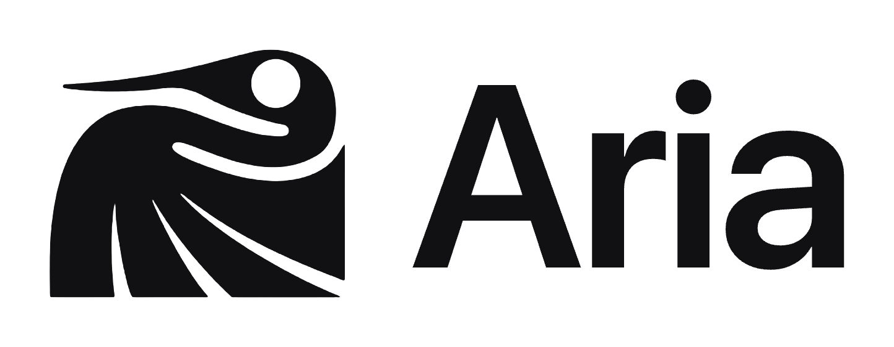
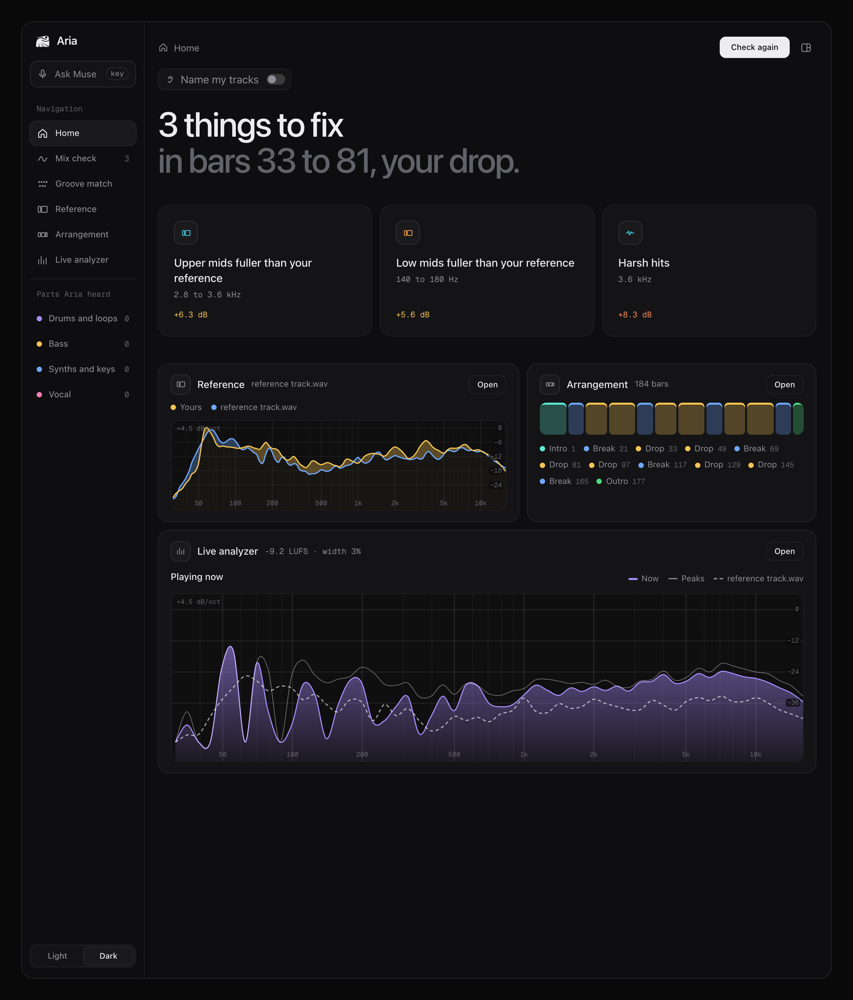
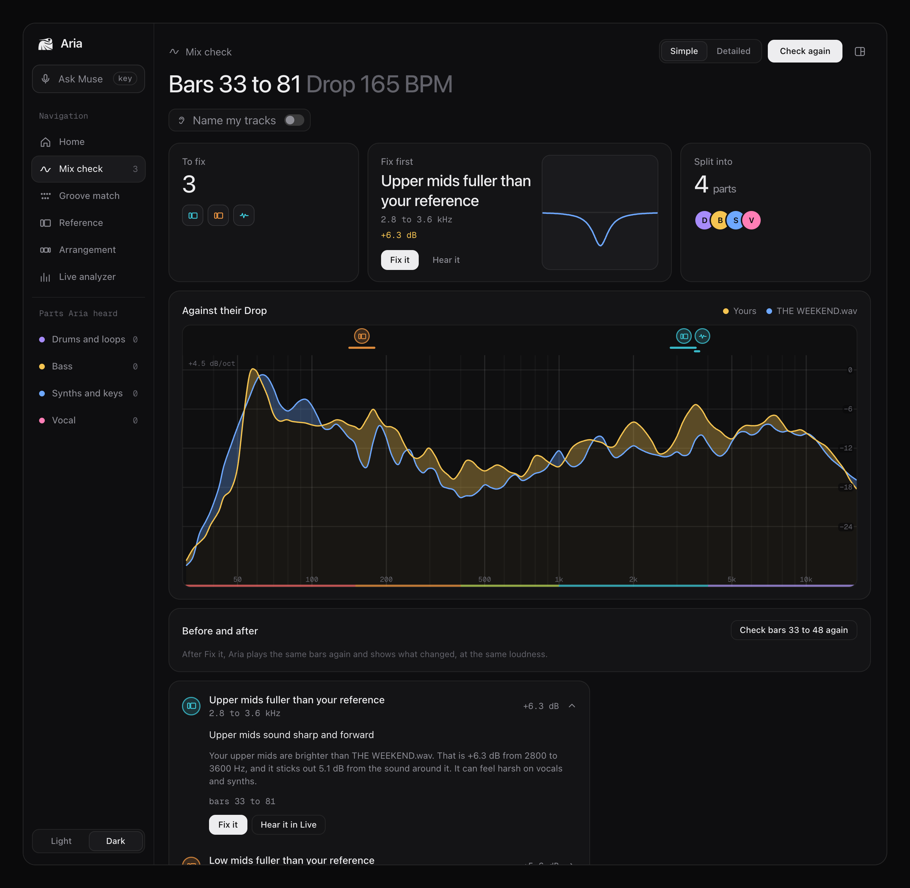
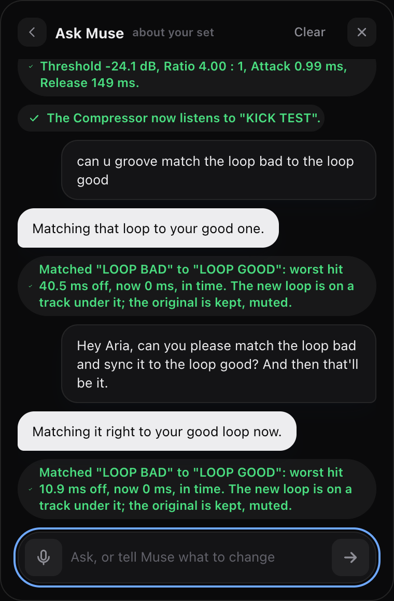
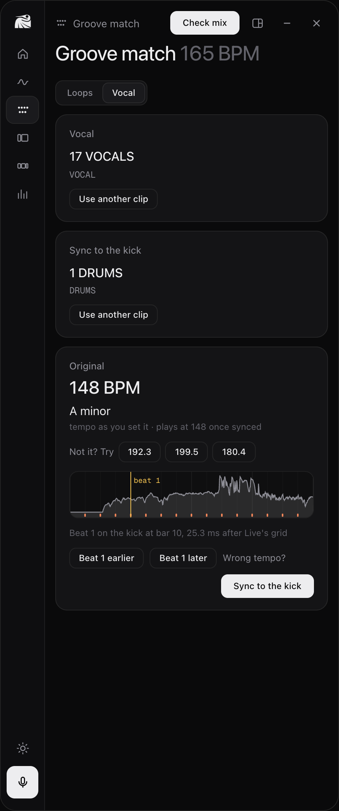
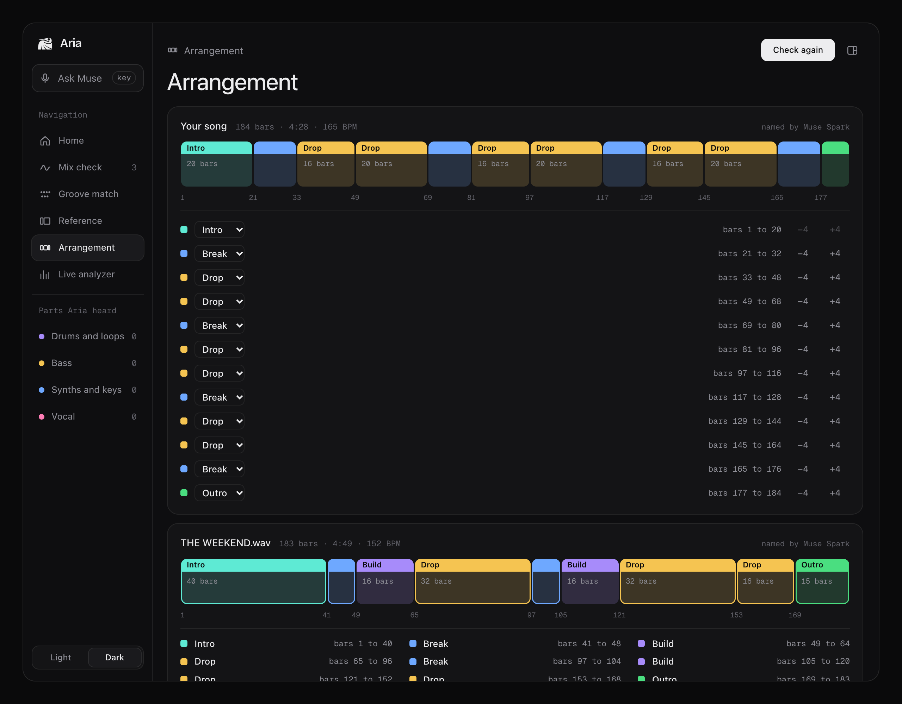
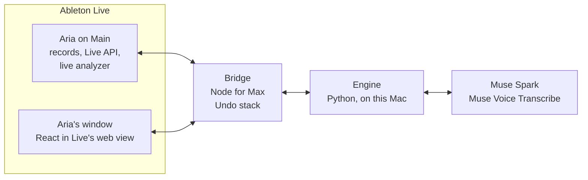

<p align="center">
  <picture>
    <source media="(prefers-color-scheme: dark)" srcset="site/public/brand/aria-logo-white.png">
    
  </picture>
</p>

<h1 align="center">Aria hears your mix, and fixes it in Ableton.</h1>

<p align="center">
  An AI co-producer that runs inside Live, on your Main track. It finds the sounds that clash or stick out,<br>
  Meta's <b>Muse Spark</b> explains them and makes the fix, and Aria measures again to prove it worked.
</p>

<table align="center">
<tr>
<td align="center" width="300"><a href="https://aria-judges.vercel.app/demo"><b>Try the demo</b></a><br><sub>Hear Aria fix a real mix in your browser.<br>No Ableton needed.</sub></td>
<td align="center" width="300"><a href="https://aria-judges.vercel.app"><b>Read the website</b></a><br><sub>What Aria does, how Meta AI powers it,<br>how it's built, and the team.</sub></td>
</tr>
</table>

<p align="center">
  <a href="https://github.com/Yumstezy/aria/releases/latest/download/Aria-mac.zip"><b>Download for Mac</b></a> &nbsp;·&nbsp;
  <a href="#get-aria">Install</a>
</p>

<p align="center"><sub>Meta Global AI Developer Hackathon, Indie track. Built Oct 26 to Nov 4, 2026.</sub></p>

<br>



<p align="center"><sub>Aria's window on Ian's own song. Every screenshot here is the real app with real results.</sub></p>

---

## Try it

**[Hear Aria fix a real mix](https://aria-judges.vercel.app/demo), no Ableton needed.** A house demo Ian made, before mixing, in four steps:

1. **Listen.** Five tracks: kick, drums, bass, leads, vocal. Tap one to hear it alone.
2. **Check.** Aria hears each track on its own: *the lead melody is buried, covered by the rest of the song most of the time.*
3. **Fix.** Muse Spark makes room instead of turning the leads up: cut the bass 3 dB at 274 Hz, lifted the leads 2 dB at 699 Hz, turned the kick down 3 dB. Then seven more requests, like *"turn the bass high frequencys cut"* and *"add reverb to my vocals"*.
4. **Compare.** Before and after, at the same loudness. The boxy low mids are 2.1 dB cleaner.

It replays Ian's real run in Live, step by step: every reply and change exactly as Aria logged it, and the After is Live's own export. The five tracks are in [`test-pack/sample`](test-pack/sample), with how to run the same thing in Live, or through the engine without Live.

---

## How it works

One problem, start to finish. Aria's loop is the same for every problem it finds.

| | |
|---|---|
| **Aria hears it.** | Mix check records 16 bars of your Main track and finds the sounds that clash or stick out, and exactly where. In Ian's drop: sharp bursts around 3620 Hz, 2.7 times a bar, bars 34 to 80. |
| **Muse Spark says it plainly.** | It gets only the measured numbers and writes what's wrong the way a producer would say it. Then it picks the fix, as an action from a fixed menu. |
| **The fix happens in Live.** | Aria checks the action against its limits, sets Live's own devices, and keeps an Undo. Ask for a change and it happens right away; a suggestion waits for your yes. |
| **Then Aria proves it worked.** | Check again plays the same bars and compares them at the same loudness. 3 dB or more lower is Fixed. On our test mix with a planted harsh boost, that range came back 6.9 dB lower. |

---

## The mix model

**Where your mix lands, from mixes people rated.** Raghav trained it on 63 mixes our testers rated good or bad, on the shape of the EQ alone, with loudness taken out. On songs it had never heard, it told good from bad 75% of the time. Chance is 50%, and a shuffle test puts luck at p = 0.002.

- **A lean, not a score.** After a Mix check, Aria shows where your mix sits, from further from the good mixes to closer, and what would move it closer: *more sub, less highs, smoother mids.*
- **Muse Spark explains it and fixes it.** It gets the model's directions as measured numbers. On Ian's rough mix: *"The sub around 42 Hz sits 6.7 dB below the good mixes."* Too much of something gets an EQ cut you can undo. Too little gets lifted on the track that carries it, never a louder fader.
- **Honest about what it is.** Loudness alone tells the same mixes apart 72% of the time, so shape isn't a stronger judge. It's the one that points to an EQ move. Aria shows only the 11 directions that pointed the same way in at least 40 of 50 test rounds ([results](ml/results/shape-experiment.md)).

---

## Why it matters

**Finishing a song stops at the mix.** Most producers learn to make a drop long before they learn why it sounds muddy next to the songs they love. The usual answers are an engineer, a course, or guessing with plugins. Aria works where they already are, in Ableton, on their own song.



- **Where, not a score.** The sound, the range and the bars: *"Upper mids fuller than your reference, 2.8 to 3.6 kHz, bars 33 to 81."*
- **Plain words.** Muse Spark writes it the way a producer would say it, from measured numbers only.
- **Never made up.** If Aria can't measure something, it says so. No example numbers, no canned advice.

---

## Meta AI

**Four of Meta's models: Muse Spark, Muse Voice Transcribe and Demucs in Aria, and Audiobox Aesthetics in our mix model tests.** Muse Spark does the work you see, not a chat box on the side. It never touches Live directly: it answers with actions from a fixed menu, Aria checks each one, and only then applies it. You can undo any change it makes.

| | |
|---|---|
| **Muse Spark writes it** `muse-spark-1.3` | Turns Aria's measurements into plain advice and a fix. It only ever sees measured numbers, and Aria checks its answer before anything happens. |
| **Muse Spark explains the mix model** | Aria's own model says where your mix lands against mixes our testers rated good or bad, and which way to move. Muse Spark turns those directions into plain advice and a fix, like any other problem. |
| **Muse Spark does it** | 24 tools in Live through tool calling: EQ, faders, 20 stock devices and 26 custom racks, sidechain, markers, groove match, vocal sync, Check again, Undo. It picks the tool a mix engineer would: drums fighting the bass get a sidechain, mud gets low cuts, a buried sound gets space made for it, never a louder fader. |
| **Muse Spark fixes the whole mix** | "Fix my whole mix": it fixes the strongest problems, Aria plays the same bars again and measures each one, and Muse reports what's fixed from the measurements alone. |
| **Muse Spark asks** | When it can't tell which track you mean, it asks: *"Which vocal track do you mean, VOCAL TEST or Vox 2?"* It also names the parts of your song: Intro, Build, Drop. |
| **Muse Spark looks at your screen** | Attach a screenshot of any plugin and it reads the settings. On EQ Eight it read *band 4, 3.62 kHz, -3.50 dB, Q 6.00* and tied it to the harsh spot Aria had measured. |
| **Muse Voice Transcribe hears it** `muse-voice-transcribe-1.0` | Hold a key and say it. *"Cut the mud on the bass"* came back as text in 1.4 seconds and ran like a typed request. |
| **Demucs splits it** `htdemucs` | Meta's open source separation model pulls the recording apart into drums, bass, vocals and the rest, so Aria can say which part is causing a problem. |
| **Audiobox Aesthetics, tested** | Meta's open model that scores how good audio sounds. We tested its scores as an input to the mix model. The model in Aria uses the EQ shape alone. |

---

## The tools

<table>
<tr>
<td width="50%" valign="top">

### Fix it, then prove it.

Fix it asks Muse Spark for the change and it happens in Live. Check again plays the same bars at the same loudness: 3 dB or more lower is Fixed. Less, and it comes back with Fix it again.

</td>
<td width="50%"></td>
</tr>
<tr>
<td width="50%"></td>
<td width="50%" valign="top">

### Ask, and it happens.

Type or say it: *"Make the drums crispier." "Sync my vocal to the kick."* You can undo each change. Aria comes with 26 custom racks built from Live's stock devices, and everything it adds is named for what it does, like Aria Sidechain.

</td>
</tr>
<tr>
<td width="50%" valign="top">

### Two loops, one groove.

Aria finds every hit to the millisecond and moves each one onto the grid or onto another loop's feel, in a new clip under the original. A perc loop 14.9 ms behind its kick came back at 0, all 32 hits. Nothing is stretched.

</td>
<td width="50%"></td>
</tr>
<tr>
<td width="50%"></td>
<td width="50%" valign="top">

### A vocal on your kick.

Drop in an acapella. Aria reads its tempo and key, puts its first beat on your kick, not just the grid (Ian's kick sits 22 to 25 ms late), and warps it with Live's own markers, reading them back to be sure they stuck.

</td>
</tr>
<tr>
<td width="50%"></td>
<td width="50%"></td>
</tr>
<tr>
<td valign="top"><b>Arrangement.</b> Aria hears the whole song and Muse Spark names its parts, so a check compares your drop with their drop.</td>
<td valign="top"><b>Live analyzer.</b> The spectrum against your reference, loudness, where the sound sits in stereo, and a waveform colored by its lows and highs.</td>
</tr>
</table>

---

## How it's built

**Four parts, one rule: report only what was measured.** If the engine can't measure something, it says so and returns nothing. Muse gets only those numbers, and its JSON is checked before anything happens.



| | |
|---|---|
| **The device** (`device/`) | Sits last on the Main track. Records bars for a check, reads and sets things through the Live API, and runs the live analyzer 20 times a second. Aria Ear, on any track, lets Aria hear that track by name. |
| **The bridge** (`device/bridge.js`) | Node for Max. Carries messages between Live, the screens and the engine, and keeps every change on an Undo stack. |
| **The engine** (`engine/`) | Python and FastAPI, on this Mac. Measures the audio and talks to Muse Spark. It returns numbers; the words come from Muse. 191 tests. |
| **The screens** (`ui/`) | React, inside Live's own web view: the strip on the device, and the window docked over Live. |

<details>
<summary>How it measures</summary>

- **The mix model:** the loudest 60 s of the check, its EQ curve in twelfth octaves against its own loudness, the same way the rated mixes were measured, then a logistic regression on 13 measurements of that curve ([`engine/aria_engine/goodmix.py`](engine/aria_engine/goodmix.py)).
- **Clarity rules:** buried sounds, mud, harsh bursts, ringing notes, bass clicks and clashing tracks, from the split parts or from each track by name, with its bars and range. A sound that ducks under the kick (a sidechain) isn't called buried during its ducks, and every finding carries each track's loudness.
- **Always at the same loudness:** reference compares and before and after are loudness matched (BS.1770, pyloudnorm).
- **Hits to the millisecond:** onsets pinned to the start of the attack, moved by slicing just before each hit, then found again in the new file by cross-correlation.
- **Vocals and kicks:** tempo from how the vocal repeats over whole bars, key from the notes it uses, kicks timed by their full sound.
- **Song parts:** a 4-bar grid, parts of 8 to 32 bars, repeats share a label, Muse Spark names them.

</details>

<details>
<summary>What broke, and how we fixed it</summary>

Found by using Aria on real songs inside Live, every day of the build.

| What broke | How we fixed it |
|---|---|
| **The device came up blank.** | Live's audio was off, which stalls Max's message queue. The device now carries its own page that says so. |
| **A result was too big to show.** Max passes its web view about 32 KB; a groove result was 50 KB. | Results are packed now, and anything too long gets a plain error. |
| **Live drops warp markers without a word.** | Markers are set in rounds and read back from Live. Aria only says Synced when they're there. |
| **Aria's checks couldn't hear Aria's own fixes.** Aria Ear sat before the fader, and Aria's EQs went in after the Ear. | Aria's devices now go in before the Ear, and the engine applies each track's fader. |
| **Muse kept turning buried sounds up.** On an unleveled mix it raised the leads three times. | Muse sees every track's loudness and makes space instead: it cuts what covers the sound, and turns down whatever is too loud. |
| **Live's browser doesn't see links.** "Name my tracks" couldn't find Aria Ear. | The installer copies the devices. |

</details>

### What didn't work

- **The mix model can't grade a mix.** Across good, mid and bad, nothing beat loudness alone: 0.49 against 0.45, and 0.51 with Audiobox Aesthetics. Only good against bad, on the EQ shape, held up, so that's what's in Aria. Adding stereo and clarity measurements didn't help (0.72 against 0.74) ([`ml/results`](ml/results)).
- **Getting the right tempo was harder than expected. Tempo detection can land on the wrong reading, especially on vocals. Aria shows the next likely tempos alongside each reading, and the song’s own tempo is one tap away.
- **Without a reference, a broad low-mid boost is hard to hear:** the rules found 1 of 3 planted problems. That's why the reference compare exists.

---

## Get Aria

**Download, double-click, drag.** You need a Mac, Ableton Live 12 Suite, Python 3.11 ([free from python.org](https://www.python.org/downloads/macos/)) and a Meta Model API key.

1. **Download** [Aria-mac.zip](https://github.com/Yumstezy/aria/releases/latest/download/Aria-mac.zip) and unzip it. Move the Aria folder where it will stay, like Documents.
2. **Double-click Install Aria.** It sets up the engine and puts Aria in Live's browser. The first time, macOS may ask: right-click it and choose Open. Paste your key into the file it opens and save.
3. **Drag Aria onto Main.** In Live: User Library, Presets, Audio Effects, Max Audio Effect, Aria. Drop it last on your Main track and press Check.

The zip has the same steps, and fixes for common problems, in **Read me first.txt**. Without a key, Aria still shows what it measured, just no advice.

<details>
<summary>From the code, and for developers</summary>

```sh
git clone https://github.com/Yumstezy/aria
cd aria
./install.sh
```

`install.sh` sets up the engine (a Python environment and `engine/.env`), copies Aria, Aria Ear and the 26 racks into Live's User Library (the scripts the devices run are linked, so `git pull` updates them), and copies the Remote Script for "Name my tracks" (in Live, once: Settings > Link, Tempo & MIDI > Control Surface: Aria).

- Engine tests: `cd engine && .venv/bin/pytest` (170 passing)
- Screens: `cd ui && npm install && npm run build` (the built pages in `ui/dist/` are committed, so running Aria never needs Node)
- Website: `cd judges && npm run build` (aria-judges.vercel.app, deployed by Vercel on every push; the demos page is `/demo`); the demo's data comes from `judges/scripts/make_demo_data.py`
- The release zip: `scripts/release.sh`
- The JSON between device, bridge, engine and screens: [`docs/contracts.md`](docs/contracts.md)
- Where things stand, day by day: [`docs/status.md`](docs/status.md)

</details>

### Security and privacy

- **Your audio stays on your Mac.** The engine listens only on `127.0.0.1`. Recordings and reference songs never leave the computer. Muse Spark gets measured numbers and your requests.
- **Your key stays yours.** It lives in `engine/.env`, read from the environment and never committed.
- **The AI can't run anything.** Muse Spark picks from a fixed menu of actions; each is checked against limits before it's applied, and every change can be undone.
- **Only Aria's pages can talk to the engine,** and every Python library is pinned to an exact version.
- **Next:** a per-install token so nothing but Aria can call the engine, and a signed, notarized installer.

---

## Team

**Three people, nine days.**

<table>
<tr>
<td align="center" width="33%"><br><b>Ian Barrie</b><br><sub>Builder</sub></td>
<td align="center" width="33%"><br><b>Dylan Haman</b><br><sub>Product manager</sub></td>
<td align="center" width="33%"><br><b>Raghav Agarwal</b><br><sub>Machine learning</sub></td>
</tr>
<tr>
<td valign="top">Built Aria end to end: the engine and its Muse Spark integration, the screens inside Live and the websites, and the Max for Live devices. Designed the product, tested it in Live every day, and now leads security.</td>
<td valign="top">Organized the team, ran planning and check-ins, and kept the build on schedule. Set priorities and coordinated the hand-offs to the submission.</td>
<td valign="top">Built the mix model: the rated mixes, their measurements, and the ordinal model with its ship rule. Ran the Audiobox side experiment and reported what it showed. Built the shape model that's in Aria.</td>
</tr>
<tr>
<td align="center"><a href="https://www.linkedin.com/in/ianabarrie/">LinkedIn</a> · <a href="https://github.com/Yumstezy">GitHub</a></td>
<td align="center"><a href="https://www.linkedin.com/in/dylan-haman-735116266/">LinkedIn</a> · <a href="https://github.com/Hamqnn">GitHub</a></td>
<td align="center"><a href="https://www.linkedin.com/in/raghav-agarwal-csu/">LinkedIn</a> · <a href="https://github.com/RaghavAgarwal18">GitHub</a></td>
</tr>
</table>

---

## The repo

```
device/      Aria and Aria Ear, the bridge (bridge.js), Live API helpers (live.js), Aria's 26 racks, the Remote Script
engine/      the engine: clarity, reference, sections, groove, vocal, Muse Spark, voice, with tests
ui/          the screens (React), built to ui/dist for Live's web view
test-pack/   the sample song for judges and testers
ml/          the rated-mix model: data, measurements, training, results, and the next experiment
judges/      the website (aria-judges.vercel.app), with the Try it demo
site/        the product page
scripts/     the release zip and its install guide
docs/        build steps, contracts, the rubric, status
```

## Rules we built by

- **No invented data.** The engine reports only what it measured; the screens never show example numbers; Muse gets only measured numbers and its answer is checked. If Muse is down, Aria shows the measurements and says advice is unavailable.
- **Plain words.** "Your choruses are too bright" first, then "+3.8 dB at 2 to 5 kHz" as the detail.
- **The producer stays in charge.** Every change can be undone. What you ask for happens; what Muse suggests waits for a yes. Third-party plugins are never changed, only shown.

## Licenses and credits

- **No commercial music** anywhere in the repo or the video. The 99 rated mixes were given to us or released for free for us to use; only their measurements are in the repo, never the audio. The sample song is Ian's own.
- **Fonts:** the system font on Mac, and Geist, bundled under the OFL.
- **Audiobox Aesthetics:** CC-BY 4.0, used in the mix model experiments (`ml/`).
- **4Times4** Ending Music Credits, ('https://soundcloud.com/4times4-music').
